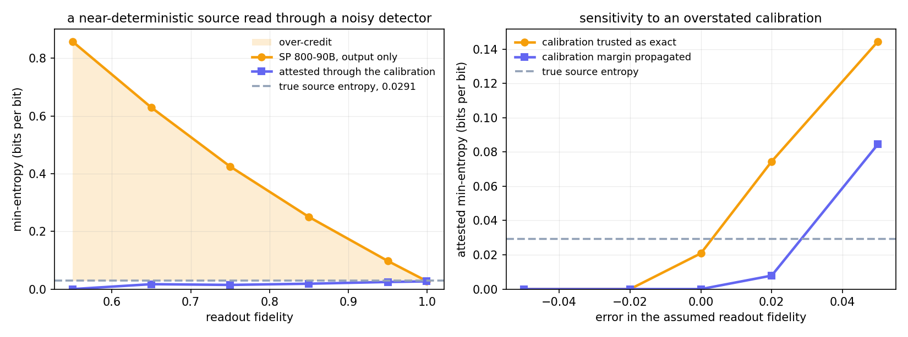
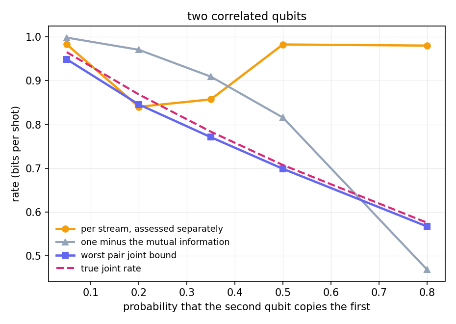
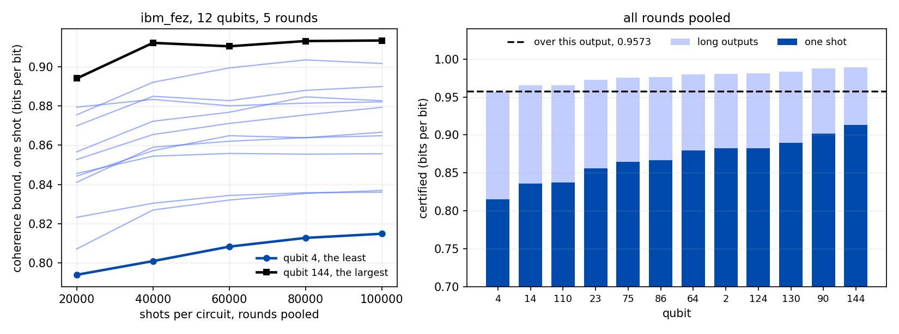

<div align="center">


**Entropy assessment and device attestation for quantum random number generation on Qiskit backends**

[](https://www.python.org/)
[](tests/)
[](pyproject.toml)
[](LICENSE)

</div>

qrng-attest measures how much of a quantum RNG's output is entropy from the quantum source and how much
is classical detector noise, crosstalk, or drift. It runs the NIST SP 800-90B assessment on the bit
stream, attests the result against the device's measured readout calibration and the measured coherence
of its source state, and sizes the extractable output. It is written in Python on numpy, with Qiskit for
the circuits and the backends.

## Use

It applies to a generator whose raw samples can be taken before any conditioning: a file from any device, or
a register of qubits on a Qiskit backend that are each prepared in |+> and measured. For a qubit source it
needs, besides the Z shots that become the output, shots of the same preparation in the X and Y bases and of
|0> and |1>; `certify_backend` takes all five. Arrays of shots have shape (shots, qubits).

| when | entry point | returns |
|---|---|---|
| raw samples of any generator are in a file | `qrng-attest capture <path>`, `assess(path, mode="bits")` | the SP 800-90B assessment: the IID verdict and the min-entropy per sample |
| the samples are in memory | `min_entropy(samples)` | the non-IID min-entropy and the value of each estimator |
| the generator is a register of qubits on a backend | `certify_backend(backend, shots=8192)`; `qrng-attest backend <name>` for a recorded device model | a certificate; the calibration, Z, X and Y circuits are run by the package |
| the shots are already taken: Z, with X and Y of the same preparation and a readout calibration | `certify_source(QuantumArraySource(shots, readout=M, x_shots=x, y_shots=y))` | the same certificate |
| uniform bits are wanted from a source that passes | `extract_from_source(source)` | the Toeplitz output, the certificate and the seed |
| the readout calibration and the gates that change the basis are not taken as known | `self_testing_entropy(ones, shots)` on the counts of `qiskit_bridge.selftest_circuits(nq)` | the dimension witness and the min-entropy it certifies, at most 0.2284 bits per round |
| a statistical battery on output bits is asked for | `sp800_22.run_battery(bits)` | the fifteen SP 800-22 tests, through the nistrng package |

Files, arrays and `certify_source` need numpy alone. A backend needs Qiskit, with qiskit-aer for a noise
model and qiskit-ibm-runtime for an IBM device; `pip install -e ".[all]"` installs every optional dependency.

A certificate is read line by line:

| line | states | used for |
|---|---|---|
| `attested min-entropy` | a lower bound on the min-entropy of one raw bit, the least over the qubits | a rate for the source; the raw bits one key needs, `cert.key_cost(256)` |
| `verdict` | PASS when X and Y shots are present, the attested value is above 0.01, and the health tests, the independence of the qubits, the drift test and the readout check all pass | a FLAGGED source is not extracted from: `extract_from_source` raises. Each `action` line names a failed check and a remedy; `advice` lines say what sets the rate |
| `extractable` | the uniform bits this run's raw bits give at the stated epsilon | the length `extract_from_source` returns |
| `bits/bit over these bits`, `long outputs` | that length per raw bit with the term that sets it, and the rate a longer run approaches | choosing the shot counts for a wanted output |
| `source coherence at least` | the lower limit on the coherence from the X and Y shots | when the line is absent the source is FLAGGED: the value holds for a pure source state only |

The attested min-entropy is the smallest of three values: the SP 800-90B assessment of the bits, the
min-entropy of the Z populations corrected for readout, and the bound of Fiorentino et al. (eq. 7) from the
coherence measured in the X and Y bases. The third is the min-entropy against an adversary who holds a
purification of the source state. Without X and Y shots the certificate says so, and its value holds for
a pure source state only.

The attested value is the min-entropy of one shot. The output length is sized from the shots taken
together: for n identical shots the smooth min-entropy is at least n times the alpha entropy of one shot
less log2(2 / eps^2) / (alpha - 1), for any alpha in (1, 2] (Tomamichel, Colbeck and Renner, Theorem 7).
The certificate gives the one shot value, the rate over its output, and the rate long outputs approach,
which is the conditional von Neumann entropy. Each qubit's SP 800-90B value caps its own stream, and the
bound for correlated qubits caps the whole.

Not provided:

- A validation. The assessment equals the output of NIST's reference software on its eleven vectors;
  conformance testing under CAVP and CMVP is a separate process.
- Device independence. The attestation takes as given a trusted and characterized measurement, the gates
  that change the basis included, and the same source state in every shot. The self-testing bound takes
  neither the preparations nor the measurements as known; it assumes a qubit, preparation and measurement
  devices that are independent, and identical rounds, and it certifies at most 0.2284 bits per round. It
  has run under backend noise models only.
- Symbols wider than 8 bits, which NIST's reference software does not take either, and the restart tests
  of SP 800-90B section 3.1.4.
- The sample count of the Recommendation from a short run. SP 800-90B section 3.1.1 asks for 1 000 000
  samples; the package assesses the stream it is given and flags a shorter one.
- A random bit generator. The package assesses an entropy source and extracts from it; SP 800-90A and
  SP 800-90C cover the generator built on one.
- An IID track compared with NIST's `ea_iid`. On 8 bit samples its chi-square test rejects good sources
  too often below about a million samples, which lowers the reported value to the non-IID one.
- Speed for streams far past a million samples. On a laptop a million bits take 3 to 8 seconds and a
  million 8 bit samples one to three minutes; on alphabets wider than bits three of the four predictors
  run one sample at a time.
- Hardware coverage past three jobs: ibm_fez with four and with twelve qubits in the Z, X and Y bases, and
  ibm_marrakesh with two qubits in the Z basis. One backend has run the three bases.

Read first:

- [USAGE.md](USAGE.md) the terms, the instructions and the limits
- [RESULTS.md](RESULTS.md) the saved runs
- NIST SP 800-90B, sections 3.1.3, 5 and 6.3: the assessment this package runs
- Fiorentino et al., Phys. Rev. A 75, 032334 (2007), eq. 7: the coherence bound

## Readout and the SP 800-90B estimate

`python -m qrng_attest.overcredit` runs a source with P(0) = 0.98, which carries 0.0291 bits/bit of
min-entropy, through a symmetric readout of fidelity F. Each observed bit is an independent draw with
`p_obs = F p + (1 - F)(1 - p)`, so the observed stream is IID.

| readout fidelity | SP 800-90B estimate | attested | estimate minus 0.0291 |
|---|---|---|---|
| 0.55 | 0.8580 | 0.0000 | +0.8289 |
| 0.75 | 0.4247 | 0.0145 | +0.3956 |
| 0.95 | 0.0974 | 0.0247 | +0.0682 |
| 0.999 | 0.0282 | 0.0268 | -0.0010 |

The attested value is at or below 0.0291 in every row. The full table is in [RESULTS.md](RESULTS.md).



The right panel shows the dependence on the calibration. The bound depends on the calibration it is
given. Treating the calibration as exact puts the attested value above 0.0291 as soon as the assumed
fidelity overstates reality. Propagating the calibration's own statistical margin holds the bound at or
below 0.0291 for any error inside that margin.

## Coherence

`python -m qrng_attest.overcredit` also runs a source whose Z outcomes are uniform and whose coherence c
varies, read through a readout of fidelity 0.99. For an adversary who holds a purification of the state, the
min-entropy of the Z outcome is -log2((1 + sqrt(1 - c^2)) / 2) (Fiorentino et al., eq. 7): 1 bit for a pure
|+>, and 0 for a classical mixture of |0> and |1>.

| coherence | true min-entropy | SP 800-90B estimate | population value | coherence bound |
|---|---|---|---|---|
| 1.000 | 1.0000 | 0.9834 | 0.9801 | 0.7277 |
| 0.990 | 0.8096 | 0.9834 | 0.9801 | 0.6740 |
| 0.900 | 0.4781 | 0.9834 | 0.9801 | 0.4372 |
| 0.500 | 0.1000 | 0.9834 | 0.9801 | 0.0887 |
| 0.000 | 0.0000 | 0.9834 | 0.9801 | 0.0000 |

The Z stream is the same in every row, so the SP 800-90B estimate and the population value do not move. The
coherence bound is at or below the truth in every row. It comes from shots in the X and Y bases, corrected
for readout at a 99 percent one sided margin, with each readout fidelity taken anywhere from its measured
value less that margin up to 1: an error seen when |0> or |1> is prepared and read may be a fault of the
prepared state, such as an imperfect reset, and a calibration from those two preparations cannot tell it
from a readout error. A qubit that starts in |1> with probability p gives a source of coherence 1 - 2p, and
the bound stays at or below eq. 7 at that value. The cost is that a readout error on a perfectly reset
qubit lowers the bound as a loss of coherence would. Near c = 1 the bound is steep in c, so the X, Y and
calibration shot counts set how close to 1 bit it can come.

That bound is for one shot. For n shots taken together, at a known coherence and no bias, the bits per
shot certified at a smoothing of 2^-65 are:

| coherence | one shot | n = 20000 | n = 1000000 | n = 100000000 | long outputs |
|---|---|---|---|---|---|
| 1.000 | 1.0000 | 0.9934 | 0.9999 | 1.0000 | 1.0000 |
| 0.998 | 0.9116 | 0.9523 | 0.9842 | 0.9882 | 0.9886 |
| 0.995 | 0.8627 | 0.9287 | 0.9688 | 0.9742 | 0.9748 |
| 0.990 | 0.8096 | 0.8994 | 0.9472 | 0.9539 | 0.9546 |
| 0.950 | 0.6080 | 0.7520 | 0.8202 | 0.8302 | 0.8313 |
| 0.900 | 0.4781 | 0.6264 | 0.7011 | 0.7124 | 0.7136 |
| 0.500 | 0.1000 | 0.1287 | 0.1796 | 0.1878 | 0.1887 |

The alpha entropy is that of the Z outcome given the purification, relative to the state that makes it
largest; at alpha = 2 and no bias it equals eq. 7, and as alpha goes to 1 it is the conditional von
Neumann entropy. With a measured coherence the package takes the least value over the confidence region:
the lower bound on c, and whichever end of the interval of the Z bias gives less.

## Correlated qubits



`python -m qrng_attest.overcredit` also runs two qubits where the second copies the first with probability
c. Both marginals stay uniform and IID, so assessing each stream separately returns close to one bit per
shot at every c, while the true joint rate falls. Debiting the mutual information is a Shannon quantity and
exceeds the true joint rate under moderate crosstalk. The worst pair joint bound is at or below the true
rate at every point, which is the bound the attestation uses.

Figures from `python -m qrng_attest.figures`, which runs the same sweeps that write
`results/overcredit.txt`.

## Hardware measurement



IBM `ibm_fez`, job `db1693rid5ic73eqnak0`: twelve qubits, no two coupled, in five rounds of the calibration, Z,
X and Y circuits; 100000 shots pooled for the calibration and for X and Y, 20000 for Z; 111 quantum
seconds on the open plan. Left: the one shot bound of each qubit as its rounds are pooled. Right: for each
qubit, the one shot bound and the rate long outputs approach; the dashed line is the rate over this job's
240000 raw bits, 229744 uniform bits. The attested value is 0.8149 bits per bit, the bound of
qubit 4. The coherence of each qubit agrees across the five rounds to 0.003.

| backend, job | qubits | shots per circuit | attested, bits per bit | uniform bits |
|---|---|---|---|---|
| ibm_fez, `db1693rid5ic73eqnak0` | 12 | 100000 for the calibration, X and Y; 20000 for Z | 0.8149 | 229744 of 240000 |
| ibm_fez, `db0rsb3id5ic73eq8em0` | 4 | 20000 | 0.7653 | 75020 of 80000 |
| ibm_marrakesh, `dablfc5e36ac739fjmmg` | 2 | 2000, Z only | 0.8607 for a pure source state; flagged on the readout of one qubit | 3316 of 4000 |

The jobs run through qiskit-ibm-runtime with the SamplerV2 primitive: the bit order of each qubit, the readout
calibration from |0> and |1> preparations, result parsing, and certificate output. Full numbers in
[RESULTS.md](RESULTS.md).

## Checks

The SP 800-90B non-IID assessment reproduces the output NIST publishes for its reference tool on the eleven
vectors of its repository to under 1e-9 bits: every estimator of both tracks, `H_original`, `H_bitstring`
and the assessed min-entropy. The three short vectors are in the test suite; `scripts/nist_vectors.py` runs
all eleven from a clone of NIST's repository. The array form of each predictor is tested for equal counts
with the translation that takes one sample at a time, at lengths on both sides of every threshold, across block edges, and
with the dictionary limits binding. The IID track, the attestation, the qubit selection, and the
extractor have unit tests over synthetic data and captured files.

The coherence bound is tested against the guessing probability of an adversary who holds a purification,
on random states, and against the known coherence of synthetic states. The alpha entropy is tested against
its definition evaluated by matrix powers on a purification, and against eq. 7 and the von Neumann
entropy at its two ends.

The assessment of a bit stream does not depend on the source. A captured file and an array in memory run the
same path.

## Features

- SP 800-90B assessment: the section 6.3 non-IID estimator suite and the section 5 IID track. The ten
  estimators reproduce NIST's `ea_non_iid` to under 1e-9 bits on its reference vectors. The four predictors
  are translated from the reference implementation and give its counts of correct predictions. On bits
  they run as array operations in blocks, with memory that does not grow with the stream; on wider
  alphabets MultiMCW, MultiMMC and LZ78Y run one sample at a time. The
  assessment is a minimum over the estimators, so dropping the predictors can only raise the reported
  entropy. `certify_source` and `certify_backend` default to `include_predictors=False`;
  `include_predictors=True` gives the bound over the whole suite, which is at or below it. Samples wider
  than one bit are assessed on the literal symbols and on the bitstring of the samples as given, and combined by the
  reference rule; `bits_per_symbol` states the sample width when the largest value does not show it.
  `assess` runs the IID permutation test at a reduced shuffle budget by default, which differs from the
  full one only by denying the IID credit more often; `--iid-full` or `iid_full=True` gives the
  reference budget of 10000 shuffles.
  `certify_source` and `certify_backend` use the full budget, because a reduced budget fails clean data
  on the fixed pass threshold.
- Device attestation: the coherence bound from X and Y basis shots, the min-entropy of the Z populations,
  readout deconvolution through the assignment matrix, correlation between qubits, drift, and the SP 800-90B
  health tests. Bounds are one sided 99 percent confidence bounds that include the sampling uncertainty
  of the data.
- Readout calibration in the same job: BackendV2's `Target` does not expose asymmetric readout fidelities, so the package
  measures the assignment matrix from |0> and |1> preparations. The calibration shot count sets the
  uncertainty budget, and the bound is the worst case over that confidence region.
- Qubit selection: reports the subset of qubits that maximizes total bits per shot.
- Randomness extraction: sizing by the leftover hash lemma and a Toeplitz extractor produce uniform output
  bits at the attested rate.
- SP 800-22 battery: with the optional `nistrng` package, `qrng_attest.sp800_22` runs the fifteen NIST
  SP 800-22 rev 1a statistical tests on the bit stream.

## Installation

```bash
pip install git+https://github.com/NikoKleion/qrng-attest
```

Not on PyPI. Install from the repository, or from a clone with `pip install -e .`.

Requires Python 3.11+ and numpy. Qiskit is optional and only needed to certify a backend:

```bash
pip install -e ".[qiskit]"    # backend bridge
pip install -e ".[runtime]"   # real IBM hardware (qiskit-ibm-runtime, SamplerV2)
pip install -e ".[aer]"       # local noise-model simulation
pip install -e ".[figures]"   # redraw the figures
pip install -e ".[sp80022]"   # SP 800-22 battery through nistrng
```

File and array assessment requires only numpy.

## Usage

A synthetic device and its certificate:

```bash
python -m qrng_attest demo --shots 4000 --qubits 3
```

```
QRNG certificate: demo QRNG  [synthetic]
  4000 shots x 3 qubits
  attested min-entropy = 0.6858 bits/bit   (verdict: PASS)
  classical estimate: IID track (source passed the IID checks)
  extractable = 9422 uniform bits at epsilon = 2^-64
    0.7852 bits/bit over these 12000 bits taken together, set by the alpha entropy at alpha = 1.229
    long outputs: at least 0.8875 to 0.8893 bits/bit by qubit
  a 256-bit key costs 558 raw bits
  source coherence at least 0.970, from X and Y basis shots
  action: no action required; re-attest after the next calibration cycle
  advice: q0: the coherence bound sets the attested rate (0.69 bits/bit at coherence 0.970); raise the X and Y basis and calibration shot counts, or check the state preparation
  note: synthetic quantum source: this run is simulated, not measured hardware
```

The other two ways in from the command line, and a synthetic device that is flagged:

```bash
python -m qrng_attest capture qrng.bin                  # a file of raw bits; --bytes for 8 bit samples
python -m qrng_attest backend manila --simulate         # the circuits under a recorded device model
python -m qrng_attest demo --qubits 4 --crosstalk 0.5   # correlated qubits, FLAGGED
```

From Python:

```python
from qrng_attest import QuantumArraySource, assess, certify_backend, certify_source, extract_from_source

cert = certify_backend(backend, shots=8192)            # calibration, Z, X and Y circuits, then the attestation
print(cert)                                            # the certificate
print(cert.rate, cert.passed, cert.plan.output_bits)   # one shot rate, verdict, uniform bits

source = QuantumArraySource(z, readout=M, calibration_shots=n, x_shots=x, y_shots=y)   # shots already taken
cert = certify_source(source)
bits, cert, seed = extract_from_source(source)         # uniform bits by Toeplitz hashing

print(assess("capture.bin", mode="bits", run_iid=True))   # a captured stream, no device
```

[USAGE.md](USAGE.md) defines each term and gives the instructions for a live IBM device.

## Related software and work

- [SP800-90B_EntropyAssessment](https://github.com/usnistgov/SP800-90B_EntropyAssessment), NIST's
  reference implementation of SP 800-90B in C++, and the source of the test vectors used here.
- [hnj2/sp800_90b](https://github.com/hnj2/sp800_90b), Python bindings to NIST's implementation through
  pybind11.
- [dj-on-github/SP800_90b_tests](https://github.com/dj-on-github/SP800_90b_tests), a Python implementation
  of the non-IID tests.
- [qiskit-rng](https://github.com/qiskit-community/qiskit_rng), archived in 2021: randomness bounded by a
  Mermin correlator on a GHZ state of three qubits, with an external extractor service.
- Li et al., Sci. Rep. 11, 23873 (2021): a source-independent QRNG on a cloud quantum computer with
  asymmetric readout error, assessed with SP 800-22 from the vendor's published calibration.
- `qiskit-experiments`, which measures the readout assignment matrix for error mitigation.

The separation of quantum from classical entropy, the handling of readout asymmetry, the leftover hash
lemma sizing and the Toeplitz extractor are published results, cited below.

## References

- NIST SP 800-90B (2018) and its [reference implementation](https://github.com/usnistgov/SP800-90B_EntropyAssessment):
  the estimators, the IID track and the test vectors.
- Fiorentino et al., Phys. Rev. A 75, 032334 (2007): the min-entropy of a qubit measured in the
  computational basis, eq. 4 for a pure state and eq. 7 for any state.
- Li et al., Sci. Rep. 11, 23873 (2021): the randomness of Z basis results bounded from X basis results on
  a cloud quantum computer, with readout errors.
- Bravyi et al., Phys. Rev. A 103, 042605 (2021): the assignment (calibration) matrix of measurement error
  mitigation.
- Lunghi et al., arXiv:1410.2790: the self-testing generator, the min-entropy certified by the dimension
  witness (eq. 5). Bowles, Quintino and Brunner, arXiv:1311.1525: the witness.
- Cao, Zhou, Yuan and Ma, arXiv:1508.04880: a source-independent generator with a trusted measurement; its
  rate 1 - H(e) in the X basis error rate e is the rate of long outputs of this package at S2 = S3 = 0.
- Impagliazzo, Levin and Luby, STOC 1989: the leftover hash lemma. Tomamichel, Schaffner, Smith and Renner,
  arXiv:1002.2436, Lemma 1 and Theorem 6: the forms that set the output length, for the min-entropy and
  for the smooth min-entropy with quantum side information. Krawczyk, CRYPTO 1994: Toeplitz hashing.
- Tomamichel, Colbeck and Renner, arXiv:0811.1221: the alpha
  entropies, their additivity over identical shots, and Theorem 7, the bound on the smooth min-entropy.
- Frauchiger, Renner and Troyer, arXiv:1311.4547: randomness extraction from realistic quantum devices with
  two-universal hashing.
- NIST SP 800-22 rev 1a (2010): the statistical test suite. Pasqualini,
  [NistRng](https://github.com/InsaneMonster/NistRng) (BSD-3): the implementation `sp800_22` calls.
- Pelofske, arXiv:2307.02573: NIST randomness tests applied to quantum annealer output.

## Scripts

`scripts/nist_vectors.py` compares the assessment with NIST's reference output.
`scripts/coherence_hardware.py` runs the source in the Z, X and Y bases with its readout calibration as one
job on one set of qubits: `dry` picks the qubits, estimates the execution time and rehearses under the
backend's noise model without submitting; `submit` checks that the account is on the open plan with free
pricing and that the allowance covers twice the estimate, caps the execution time, and submits; `collect`
saves the shots and prints the certificate. `scripts/coherence_rounds.py` takes the same five circuits in
rounds on twelve qubits, with the same three commands and the same checks before submission, and tabulates
each qubit's coherence per round and its bound after each round; its `submit` acts only on the word `go`,
stops for a plan older than an hour, one that differs from the script's job, an estimate above 117 s, or an
allowance that would fall under 120 s if the job ran to its cap, and then watches the job and cancels it
if it runs past the cap. The rest of `scripts/` holds the IBM
workflow, run from the repository root. `setup_account.py` saves credentials from a local file, so the token
is never typed on a command line. `run_hardware.py` certifies one small job, with `--dry-run` on a local fake
device, which uses no QPU time. `submit_job.py` queues a job and returns, and `poll_job.py` or `wait_job.py`
picks the result up afterward.

## Documentation

- [USAGE.md](USAGE.md) instructions, terms, and the limits of the tool
- [RESULTS.md](RESULTS.md) the saved runs, with output in `results/`
- [CONTRIBUTING.md](CONTRIBUTING.md) the tests and conventions a change is held to
- [SECURITY.md](SECURITY.md) reporting a vulnerability, or a value that credits more entropy than a source holds

## Support

Maintained by Nikolas Klein. Questions and bug reports go to the issue tracker and are answered on a
best effort basis; security reports follow [SECURITY.md](SECURITY.md).

## Citation

[CITATION.cff](CITATION.cff) gives the citation.

## License

Apache License 2.0, see [LICENSE](LICENSE). Copyright 2026 Nikolas Klein. Third party material and its notices
are listed in [NOTICE](NOTICE). Qiskit is a trademark of International Business Machines Corporation; this
project is not affiliated with or endorsed by IBM or NIST.
